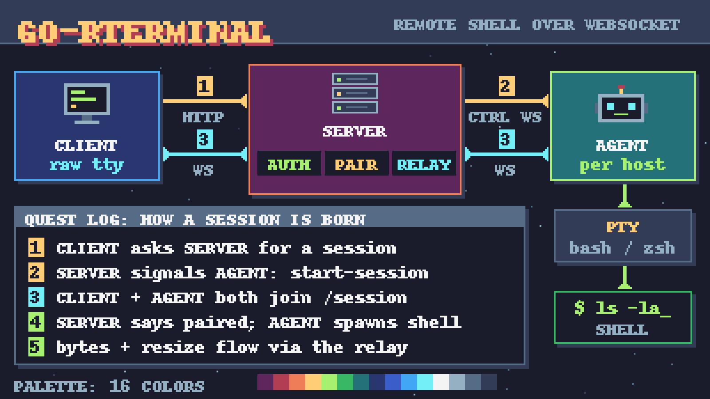
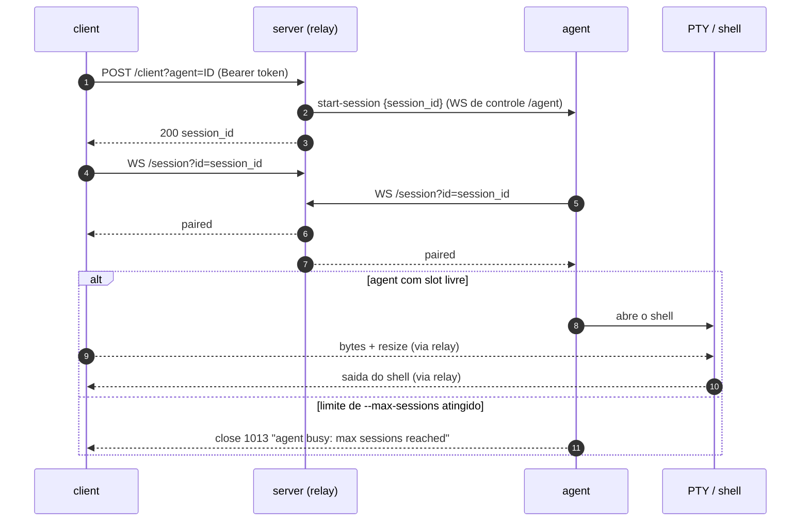
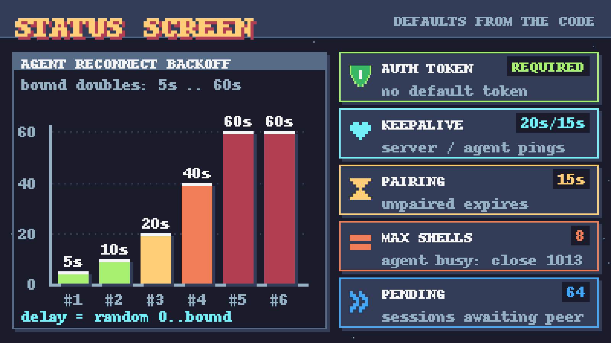

# go-rterminal

go-rterminal e um projeto simples para criar sessoes de shell remotas via WebSocket. Ele e dividido em tres componentes:

- **server**: coordena agentes e clientes, autentica, pareia as pontas e faz o relay dos bytes
- **agent**: conecta ao server e abre um shell local em PTY quando um cliente pede
- **client**: conecta ao server e interage com a sessao em modo raw, com resize do terminal

Opcionalmente o server tambem serve um **painel de administracao** web (veja [Painel de administracao](#painel-de-administracao)): cadastro de maquinas e grupos, geracao do comando de instalacao do agent, status online/offline, terminal no navegador e auditoria.

O fluxo e: o client pede uma nova sessao ao server, o server aciona o agent, os dois entram na sessao, o server avisa que a sessao esta pareada, e a comunicacao passa a fluir entre client e agent.

## Arquitetura



Os numeros do diagrama sao os mesmos do fluxo abaixo:



O codigo compartilhado fica em `internal/`:

- `protocol`: mensagens e tipos do protocolo (`register-agent`, `start-session`, `paired`, `resize`)
- `relay`: estado, autenticacao, pareamento, keepalive e relay do servidor
- `store`: persistencia em SQLite (admins, grupos, maquinas, auditoria)
- `admin`: API REST, login do administrador, terminal web e a interface embutida (`internal/admin/web`)
- `auth`: resolucao do token (flag ou `RTERMINAL_TOKEN`) e header `Authorization`
- `endpoint`: montagem e validacao das URLs HTTP/WS
- `tlsutil`: configuracao TLS comum ao client e agent
- `backoff`: politica de reconexao do agent

### Endpoints do server

| Endpoint | Metodo | Quem usa | Descricao |
| --- | --- | --- | --- |
| `/agent` | WebSocket | agent | registra o agent (`register-agent`) e mantem o canal de controle |
| `/client?agent=ID` | `POST` | client | pede uma sessao ao agent; retorna o `session_id` |
| `/session?id=ID` | WebSocket | client e agent | as duas pontas entram na mesma sessao e o server faz o relay |
| `/healthz` | `GET` | operacao | retorna `200 OK` com corpo `ok` |

Todos exigem `Authorization: Bearer <token>`, exceto `/healthz`. No modo legado o token e o mesmo para agents e clientes; no modo com painel (`--db`), cada agent usa a credencial da propria maquina (veja abaixo).

## Requisitos

- Go 1.27+ (conforme `go.mod`)
- Acesso local a `127.0.0.1:8080` (ajuste via flags se necessario)
- Sistemas suportados:
  - `server`: Linux, macOS, Windows
  - `client`: Linux, macOS, Windows (sem resize automatico no Windows)
  - `agent`: Linux, macOS (usa PTY; nao funciona no Windows)

## Como executar

O token e obrigatorio e `change-me` e rejeitado. Gere um (ex: `export TOKEN=$(openssl rand -hex 32)`) ou use a variavel `RTERMINAL_TOKEN`, que evita expor o token em `ps`.

1. Subir o server:

```bash
go run ./cmd/server --addr :8080 --auth-token "$TOKEN"
```

2. Subir o agent:

```bash
go run ./cmd/agent --server-url ws://127.0.0.1:8080 --agent-id agent-01 --shell /bin/bash --auth-token "$TOKEN"
```

3. Subir o client:

```bash
go run ./cmd/client --server-url http://127.0.0.1:8080 --agent-id agent-01 --auth-token "$TOKEN"
```

Tambem da para usar o `Makefile` (`make help`) ou o Docker Compose:

```bash
export AUTH_TOKEN=$(openssl rand -hex 32)
docker compose up --build            # server + agent
docker compose run --rm client       # client interativo
```

## Painel de administracao

Passando `--db` ao server, ele passa a guardar maquinas e grupos em SQLite e serve uma interface web na mesma porta. Exemplo para um homelab (notebook, Raspberry e um servidor remoto):

```bash
go run ./cmd/server --addr :8080 --db rterminal.db --public-url https://rt.exemplo.com
```

**Primeiro acesso.** Quando o banco ainda nao tem administrador, o server cria o usuario `admin` (`--admin-user`) com uma **senha temporaria aleatoria** e a mostra nos logs, uma unica vez:

```text
[server] PRIMEIRO ACESSO: administrador criado com senha TEMPORARIA
[server]   usuario: admin
[server]   senha:   ANSdnHGbR4b4A-uqvIUkObVB
```

Entre em `http://localhost:8080/` com ela: a interface pede uma senha nova (minimo de 8 caracteres) e nada mais funciona ate a troca. A troca encerra as outras sessoes do usuario. Depois, **Alterar senha** no topo da tela faz o mesmo quando quiser.

- Se preferir definir a senha inicial, use `RTERMINAL_ADMIN_PASSWORD` (sem troca obrigatoria).
- **Perdeu a senha?** Gere outra temporaria, com troca obrigatoria, no proprio banco: `server reset-password --db rterminal.db --user admin` (em Docker: `docker exec rterminal-server /usr/local/bin/server reset-password --db /data/rterminal.db --user admin`). As sessoes abertas sao encerradas.

1. Crie o grupo (ex: `homelab`) em **Grupos > + Novo**.
2. Clique em **+ Adicionar maquina**, informe o nome (ex: `Raspberry Pi`) e o grupo.
3. A interface mostra o comando para rodar na maquina (binario, servico systemd e instalacao do agent). Ele carrega a **credencial da maquina**, exibida so uma vez.
4. Rode o comando na maquina. Ela aparece como **online**, com hostname, SO e arquitetura, e o botao **Terminal** abre um shell no navegador.

O comando gerado tem a forma `RTERMINAL_TOKEN=<credencial> agent --server-url wss://... --agent-id raspberry-pi`. Use `--public-url` para o endereco externo correto (principalmente atras de proxy reverso); sem ele, usa o host da requisicao.

Como funciona:

- **Credencial por maquina**: guardada so como hash (SHA-256). O `agent-id` vem da credencial, entao um agent nao consegue se passar por outro. **Nova credencial** invalida a antiga e derruba o agent conectado; **Excluir** tambem o desconecta.
- **Login do administrador**: senha com bcrypt, cookie `HttpOnly` + `SameSite=Strict` (e `Secure` com HTTPS), HSTS quando o `--public-url` e https, limite de tentativas por IP e por usuario (tambem na troca de senha), e protecao CSRF (cabecalho `X-Requested-With` em toda escrita). O WebSocket do terminal recusa origens diferentes.
- **Auditoria**: logins, falhas de login, mudancas em grupos e maquinas, rotacao de credenciais e cada terminal aberto.
- **Clientes CLI**: com `--db`, `--auth-token` passa a ser opcional e so autentica o client de linha de comando, com acesso a qualquer maquina online. Sem ele, so o painel abre sessoes.

Limites desta versao: ha um unico papel (administrador); os grupos organizam as maquinas, mas ainda nao restringem acesso. Nao ha rede entre as maquinas (IP, ping): isso e outro produto. Use HTTPS (`--tls-cert`/`--tls-key` ou um proxy como acima): sem TLS, a senha e as credenciais trafegam em texto puro, e o server avisa no log.

Para Raspberry e outras arquiteturas, compile o agent com `GOOS=linux GOARCH=arm64 CGO_ENABLED=0 go build ./cmd/agent` (ou `GOARCH=arm` para ARMv7), ou use `docker buildx build --platform linux/arm64 --target agent .`.

### Deploy com Docker (Portainer + nginx-proxy)

`deploy/server/docker-compose.yml` sobe so o server com o painel, pensado para uma **stack do Portainer** atras de um **nginx-proxy** (com acme-companion/Let's Encrypt) que voce ja tem rodando. Ele nao publica porta no host: o proxy o alcanca pela rede Docker que os dois compartilham.

1. No Portainer: **Stacks > Add stack > Repository**, com a URL do repositorio e o *Compose path* `deploy/server/docker-compose.yml` (o build usa o `Dockerfile` da raiz, alvo `server`).
2. Em **Environment variables**, cadastre as de `deploy/server/.env.example`:
   - `DOMAIN`: dominio que ja aponta (DNS) para o servidor do proxy
   - `LETSENCRYPT_EMAIL`: email do Let's Encrypt
   - `PROXY_NETWORK`: nome da rede Docker do seu nginx-proxy (**Networks** no Portainer)
   - `TRUSTED_PROXIES`: faixa (*Subnet*) dessa rede, para o server enxergar o IP real do cliente
3. Faca o deploy. O nginx-proxy detecta `VIRTUAL_HOST`/`LETSENCRYPT_HOST`, emite o certificado e passa a servir `https://DOMAIN/` (WebSockets incluidos, sem configuracao extra: o server envia pings a cada 20s, menos que o timeout padrao de 60s do nginx).
4. Pegue a senha temporaria em **Stacks > (stack) > server > Logs** (procure `PRIMEIRO ACESSO`) e entre para trocá-la.

O banco fica no volume `rterminal-data` (`/data`), entao sobrevive a atualizacoes da stack. O container roda sem privilegios, com sistema de arquivos somente leitura e sem capabilities. As maquinas usam `wss://DOMAIN` nos comandos gerados.

## Flags disponiveis

### server

- `--addr` endereco de escuta HTTP (ex: `:8080`)
- `--auth-token` token compartilhado (ou `RTERMINAL_TOKEN`); obrigatorio no modo legado, opcional com `--db` (so clientes CLI)
- `--db` arquivo SQLite; ativa o painel de administracao e as credenciais por maquina
- `--public-url` URL publica do server, usada nos comandos gerados (ex: `https://rt.exemplo.com`)
- `--admin-user` usuario do primeiro administrador (padrao `admin`); a senha inicial e temporaria, gerada e logada uma vez (ou vem de `RTERMINAL_ADMIN_PASSWORD`)
- `--trusted-proxies` CIDRs dos proxies reversos cujo `X-Forwarded-For` e confiavel (ex: `172.16.0.0/12`); sem isso, atras de um proxy todos os logins pareceriam vir do IP do proxy
- `--tls-cert` caminho do certificado TLS (opcional)
- `--tls-key` caminho da chave TLS (opcional)
- `--session-timeout` timeout para pareamento de sessao (padrao `15s`, `0` desativa)

### agent

- `--server-url` URL WS do server (ex: `ws://127.0.0.1:8080`)
- `--agent-id` ID do agent (ex: `agent-01`); com o painel, use o ID mostrado no comando gerado
- `--shell` shell para abrir no agente (ex: `/bin/bash`)
- `--auth-token` token de autenticacao (obrigatorio; ou `RTERMINAL_TOKEN`); com o painel, e a credencial da maquina
- `--tls-ca` caminho do CA para TLS (opcional)
- `--tls-insecure` ignora verificacao TLS (nao recomendado)
- `--backoff-min` backoff minimo para reconexao (padrao `5s`)
- `--backoff-max` backoff maximo para reconexao (padrao `60s`)
- `--keepalive-interval` intervalo de keepalive no controle (padrao `15s`, `0` desativa)
- `--max-sessions` maximo de sessoes de shell simultaneas (padrao `8`, `0` sem limite)

### client

- `--server-url` URL HTTP do server (ex: `http://127.0.0.1:8080`)
- `--agent-id` ID do agent alvo (ex: `agent-01`)
- `--auth-token` token de autenticacao (obrigatorio; ou `RTERMINAL_TOKEN`)
- `--tls-ca` caminho do CA para TLS (opcional)
- `--tls-insecure` ignora verificacao TLS (nao recomendado)

## Comportamento e padroes



- **Token obrigatorio**: nao existe token padrao; sem `--auth-token` nem `RTERMINAL_TOKEN` o processo nao sobe (o server com `--db` e a excecao: usa credenciais por maquina).
- **Agent unico por ID**: um segundo agent com o mesmo `agent-id` e recusado enquanto o primeiro responde a pings; uma conexao morta e substituida.
- **Shell so apos o pareamento**: o agent abre o shell apenas quando o server envia `paired`, entao sessoes que ninguem pareou nao gastam processo nem slot. Elas expiram em `--session-timeout`.
- **Limite de sessoes**: acima de `--max-sessions`, o client recebe `agent busy` (close 1013) na hora. Sessoes aguardando pareamento tambem tem um teto interno (64).
- **Keepalive**: o server envia ping a cada 20s para agents e sessoes pareadas e derruba quem ficar mudo por 40s. O agent tambem envia pings no canal de controle (`--keepalive-interval`).
- **Reconexao**: o agent reconecta com backoff exponencial e jitter completo (o atraso e sorteado entre `0` e o limite do grafico acima); o limite volta ao minimo ao conectar.
- **Resize**: o client reenvia o tamanho do terminal a cada `SIGWINCH` (Linux e macOS).
- **Limpeza**: ao fechar a sessao, o agent envia `SIGHUP` e depois `SIGKILL` a todos os processos da sessao do shell, inclusive jobs em background, e antes disso esvazia a saida pendente do PTY.
- **Shutdown gracioso**: `SIGINT`/`SIGTERM` encerram o server (`Shutdown` com 10s) e o agent (que encerra as sessoes ativas).

## Testes

```bash
go vet ./...
go test -race ./...
```

Os testes do `agent` rodam shells reais atras de um relay em `httptest` (saida completa, limpeza de processos filhos e pareamento).

## O que este projeto representa

Este projeto e uma base enxuta para estudar e testar:

- pareamento de clientes e agentes via WebSocket
- multiplexacao simples de sessoes
- comunicacao de terminal em modo raw com PTY, incluindo resize
- ciclo de vida de processos filhos em sessoes de PTY

Ele inclui autenticacao por token (ou por credencial de maquina, com o painel), auditoria basica no painel e suporte opcional a TLS, mas nao faz autorizacao por usuario ou por grupo, isolamento do shell ou criptografia propria. No modo legado o token e compartilhado por todos os agents e clientes; no painel, quem e administrador pode abrir um shell em qualquer maquina, entao proteja esse acesso (senha forte, HTTPS). Use `wss`/`https` fora de uma rede local confiavel. O agent concede ao usuario remoto os mesmos privilegios do processo que o executa; use uma conta dedicada e com privilegios minimos.

## Imagens

As imagens de `docs/images/` seguem o estilo 16 bits (paleta Sweetie-16, exatamente 16 cores) e sao geradas por `docs/images/gen.py` (precisa de Pillow):

```bash
python3 docs/images/gen.py
```

## Autor

Feito com ❤️ por **Thiago Zilli Sarmento**.

## License

Este projeto esta sob a licenca MIT. Veja o arquivo [LICENSE](LICENSE) para o texto completo.
