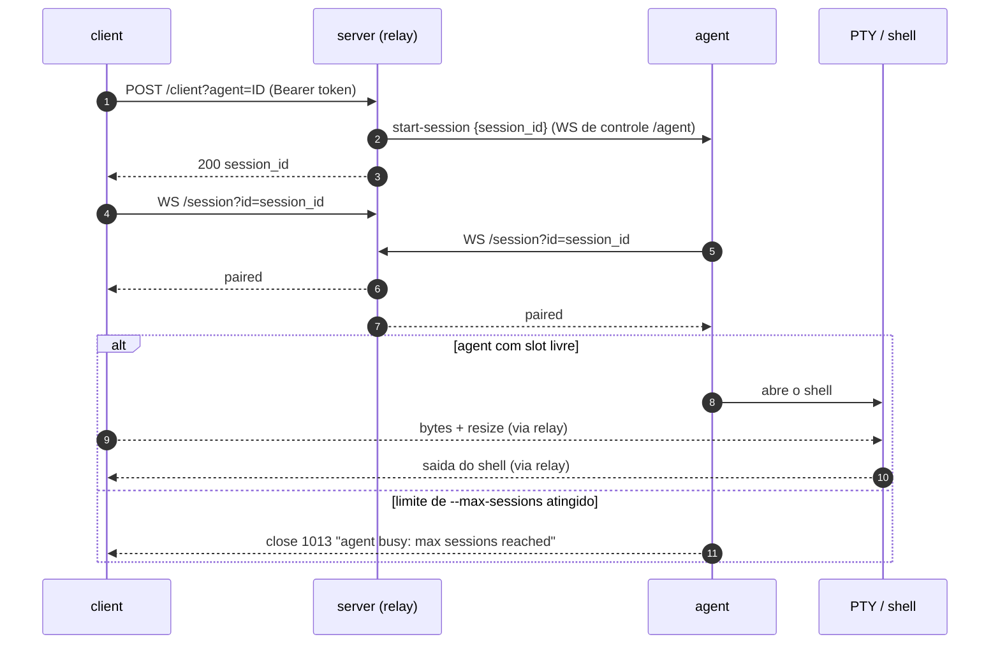

# go-rterminal

go-rterminal e um projeto simples para criar sessoes de shell remotas via WebSocket. Ele e dividido em tres componentes:

- **server**: coordena agentes e clientes, autentica, pareia as pontas e faz o relay dos bytes
- **agent**: conecta ao server e abre um shell local em PTY quando um cliente pede
- **client**: conecta ao server e interage com a sessao em modo raw, com resize do terminal

O fluxo e: o client pede uma nova sessao ao server, o server aciona o agent, os dois entram na sessao, o server avisa que a sessao esta pareada, e a comunicacao passa a fluir entre client e agent.

## Arquitetura


Os numeros do diagrama sao os mesmos do fluxo abaixo:



O codigo compartilhado fica em `internal/`:

- `protocol`: mensagens e tipos do protocolo (`register-agent`, `start-session`, `paired`, `resize`)
- `relay`: estado, autenticacao, pareamento, keepalive e relay do servidor
- `auth`: resolucao do token (flag ou `RTERMINAL_TOKEN`) e header `Authorization`
- `endpoint`: montagem e validacao das URLs HTTP/WS
- `tlsutil`: configuracao TLS comum ao client e agent
- `backoff`: politica de reconexao do agent

### Endpoints do server

| Endpoint | Metodo | Quem usa | Descricao |
| --- | --- | --- | --- |
| `/agent` | WebSocket | agent | registra o agent (`register-agent`) e mantem o canal de controle |
| `/client?agent=ID` | `POST` | client | pede uma sessao ao agent; retorna o `session_id` |
| `/session?id=ID` | WebSocket | client e agent | as duas pontas entram na mesma sessao e o server faz o relay |
| `/healthz` | `GET` | operacao | retorna `200 OK` com corpo `ok` |

Todos exigem `Authorization: Bearer <token>`, exceto `/healthz`.

## Requisitos

- Go 1.27+ (conforme `go.mod`)
- Acesso local a `127.0.0.1:8080` (ajuste via flags se necessario)
- Sistemas suportados:
  - `server`: Linux, macOS, Windows
  - `client`: Linux, macOS, Windows (sem resize automatico no Windows)
  - `agent`: Linux, macOS (usa PTY; nao funciona no Windows)

## Como executar

O token e obrigatorio e `change-me` e rejeitado. Gere um (ex: `export TOKEN=$(openssl rand -hex 32)`) ou use a variavel `RTERMINAL_TOKEN`, que evita expor o token em `ps`.

1. Subir o server:

```bash
go run ./cmd/server --addr :8080 --auth-token "$TOKEN"
```

2. Subir o agent:

```bash
go run ./cmd/agent --server-url ws://127.0.0.1:8080 --agent-id agent-01 --shell /bin/bash --auth-token "$TOKEN"
```

3. Subir o client:

```bash
go run ./cmd/client --server-url http://127.0.0.1:8080 --agent-id agent-01 --auth-token "$TOKEN"
```

Tambem da para usar o `Makefile` (`make help`) ou o Docker Compose:

```bash
export AUTH_TOKEN=$(openssl rand -hex 32)
docker compose up --build            # server + agent
docker compose run --rm client       # client interativo
```

## Flags disponiveis

### server

- `--addr` endereco de escuta HTTP (ex: `:8080`)
- `--auth-token` token de autenticacao (obrigatorio; ou `RTERMINAL_TOKEN`)
- `--tls-cert` caminho do certificado TLS (opcional)
- `--tls-key` caminho da chave TLS (opcional)
- `--session-timeout` timeout para pareamento de sessao (padrao `15s`, `0` desativa)

### agent

- `--server-url` URL WS do server (ex: `ws://127.0.0.1:8080`)
- `--agent-id` ID do agent (ex: `agent-01`)
- `--shell` shell para abrir no agente (ex: `/bin/bash`)
- `--auth-token` token de autenticacao (obrigatorio; ou `RTERMINAL_TOKEN`)
- `--tls-ca` caminho do CA para TLS (opcional)
- `--tls-insecure` ignora verificacao TLS (nao recomendado)
- `--backoff-min` backoff minimo para reconexao (padrao `5s`)
- `--backoff-max` backoff maximo para reconexao (padrao `60s`)
- `--keepalive-interval` intervalo de keepalive no controle (padrao `15s`, `0` desativa)
- `--max-sessions` maximo de sessoes de shell simultaneas (padrao `8`, `0` sem limite)

### client

- `--server-url` URL HTTP do server (ex: `http://127.0.0.1:8080`)
- `--agent-id` ID do agent alvo (ex: `agent-01`)
- `--auth-token` token de autenticacao (obrigatorio; ou `RTERMINAL_TOKEN`)
- `--tls-ca` caminho do CA para TLS (opcional)
- `--tls-insecure` ignora verificacao TLS (nao recomendado)

## Comportamento e padroes


- **Token obrigatorio**: nao existe token padrao; sem `--auth-token` nem `RTERMINAL_TOKEN` o processo nao sobe.
- **Agent unico por ID**: um segundo agent com o mesmo `agent-id` e recusado enquanto o primeiro responde a pings; uma conexao morta e substituida.
- **Shell so apos o pareamento**: o agent abre o shell apenas quando o server envia `paired`, entao sessoes que ninguem pareou nao gastam processo nem slot. Elas expiram em `--session-timeout`.
- **Limite de sessoes**: acima de `--max-sessions`, o client recebe `agent busy` (close 1013) na hora. Sessoes aguardando pareamento tambem tem um teto interno (64).
- **Keepalive**: o server envia ping a cada 20s para agents e sessoes pareadas e derruba quem ficar mudo por 40s. O agent tambem envia pings no canal de controle (`--keepalive-interval`).
- **Reconexao**: o agent reconecta com backoff exponencial e jitter completo (o atraso e sorteado entre `0` e o limite do grafico acima); o limite volta ao minimo ao conectar.
- **Resize**: o client reenvia o tamanho do terminal a cada `SIGWINCH` (Linux e macOS).
- **Limpeza**: ao fechar a sessao, o agent envia `SIGHUP` e depois `SIGKILL` a todos os processos da sessao do shell, inclusive jobs em background, e antes disso esvazia a saida pendente do PTY.
- **Shutdown gracioso**: `SIGINT`/`SIGTERM` encerram o server (`Shutdown` com 10s) e o agent (que encerra as sessoes ativas).

## Testes

```bash
go vet ./...
go test -race ./...
```

Os testes do `agent` rodam shells reais atras de um relay em `httptest` (saida completa, limpeza de processos filhos e pareamento).

## O que este projeto representa

Este projeto e uma base enxuta para estudar e testar:

- pareamento de clientes e agentes via WebSocket
- multiplexacao simples de sessoes
- comunicacao de terminal em modo raw com PTY, incluindo resize
- ciclo de vida de processos filhos em sessoes de PTY

Ele inclui autenticacao simples por token e suporte opcional a TLS, mas nao faz autorizacao por usuario ou por agent, auditoria, isolamento do shell ou criptografia propria. O token e compartilhado por todos os agents e clientes, e quem o possui pode abrir um shell em qualquer agent. Use `wss`/`https` fora de uma rede local confiavel. O agent concede ao usuario remoto os mesmos privilegios do processo que o executa; use uma conta dedicada e com privilegios minimos.

## Imagens

As imagens de `docs/images/` seguem o estilo 16 bits (paleta Sweetie-16, exatamente 16 cores) e sao geradas por `docs/images/gen.py` (precisa de Pillow):

```bash
python3 docs/images/gen.py
```

## Autor

Feito com ❤️ por **Thiago Zilli Sarmento**.

## License

Este projeto esta sob a licenca MIT. Veja o arquivo [LICENSE](LICENSE) para o texto completo.
