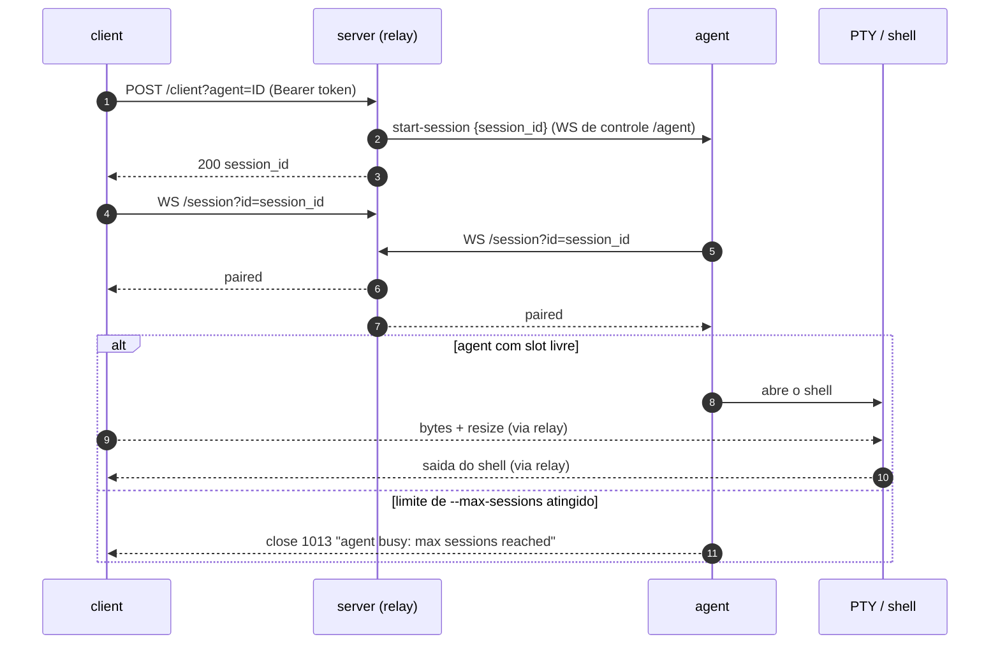

# go-rterminal

go-rterminal e um projeto simples para criar sessoes de shell remotas via WebSocket. Ele e dividido em tres componentes:

- **server**: coordena agentes e clientes, autentica, pareia as pontas e faz o relay dos bytes
- **agent**: conecta ao server e abre um shell local em PTY quando um cliente pede
- **client**: conecta ao server e interage com a sessao em modo raw, com resize do terminal

Opcionalmente o server tambem serve um **painel de administracao** web (veja [Painel de administracao](#painel-de-administracao)): cadastro de maquinas e grupos, geracao do comando de instalacao do agent, status online/offline, terminal no navegador e auditoria.

O fluxo e: o client pede uma nova sessao ao server, o server aciona o agent, os dois entram na sessao, o server avisa que a sessao esta pareada, e a comunicacao passa a fluir entre client e agent.

## Arquitetura


Os numeros do diagrama sao os mesmos do fluxo abaixo:



O codigo compartilhado fica em `internal/`:

- `protocol`: mensagens e tipos do protocolo (`register-agent`, `start-session`, `paired`, `resize`)
- `relay`: estado, autenticacao, pareamento, keepalive e relay do servidor
- `store`: persistencia em SQLite (admins, grupos, maquinas, auditoria)
- `admin`: API REST, login do administrador, terminal web e a interface embutida (`internal/admin/web`)
- `auth`: resolucao do token (flag ou `RTERMINAL_TOKEN`) e header `Authorization`
- `endpoint`: montagem e validacao das URLs HTTP/WS
- `tlsutil`: configuracao TLS comum ao client e agent
- `backoff`: politica de reconexao do agent

### Endpoints do server

| Endpoint | Metodo | Quem usa | Descricao |
| --- | --- | --- | --- |
| `/agent` | WebSocket | agent | registra o agent (`register-agent`) e mantem o canal de controle |
| `/client?agent=ID` | `POST` | client | pede uma sessao ao agent; retorna o `session_id` |
| `/session?id=ID` | WebSocket | client e agent | as duas pontas entram na mesma sessao e o server faz o relay |
| `/healthz` | `GET` | operacao | retorna `200 OK` com corpo `ok` |

Todos exigem `Authorization: Bearer <token>`, exceto `/healthz`. No modo legado o token e o mesmo para agents e clientes; no modo com painel (`--db`), cada agent usa a credencial da propria maquina (veja abaixo).

## Requisitos

- Go 1.27+ (conforme `go.mod`)
- Acesso local a `127.0.0.1:8080` (ajuste via flags se necessario)
- Sistemas suportados:
  - `server`: Linux, macOS, Windows
  - `client`: Linux, macOS, Windows (sem resize automatico no Windows)
  - `agent`: Linux, macOS (usa PTY; nao funciona no Windows)

## Como executar

O token e obrigatorio e `change-me` e rejeitado. Gere um (ex: `export TOKEN=$(openssl rand -hex 32)`) ou use a variavel `RTERMINAL_TOKEN`, que evita expor o token em `ps`.

1. Subir o server:

```bash
go run ./cmd/server --addr :8080 --auth-token "$TOKEN"
```

2. Subir o agent:

```bash
go run ./cmd/agent --server-url ws://127.0.0.1:8080 --agent-id agent-01 --shell /bin/bash --auth-token "$TOKEN"
```

3. Subir o client:

```bash
go run ./cmd/client --server-url http://127.0.0.1:8080 --agent-id agent-01 --auth-token "$TOKEN"
```

Tambem da para usar o `Makefile` (`make help`) ou o Docker Compose:

```bash
export AUTH_TOKEN=$(openssl rand -hex 32)
docker compose up --build            # server + agent
docker compose run --rm client       # client interativo
```

## Painel de administracao

Passando `--db` ao server, ele passa a guardar maquinas e grupos em SQLite e serve uma interface web na mesma porta. Exemplo para um homelab (notebook, Raspberry e um servidor remoto):

```bash
go run ./cmd/server --addr :8080 --db rterminal.db --public-url https://rt.exemplo.com
```

**Primeiro acesso.** Quando o banco ainda nao tem administrador, o server cria o usuario `admin` (`--admin-user`) com uma **senha temporaria aleatoria** e a mostra nos logs, uma unica vez:

```text
[server] PRIMEIRO ACESSO: administrador criado com senha TEMPORARIA
[server]   usuario: admin
[server]   senha:   ANSdnHGbR4b4A-uqvIUkObVB
```

Entre em `http://localhost:8080/` com ela: a interface pede uma senha nova (minimo de 8 caracteres) e nada mais funciona ate a troca. A troca encerra as outras sessoes do usuario. Depois, **Alterar senha** no topo da tela faz o mesmo quando quiser.

- Se preferir definir a senha inicial, use `RTERMINAL_ADMIN_PASSWORD` (sem troca obrigatoria).
- **Perdeu a senha?** Gere outra temporaria, com troca obrigatoria, no proprio banco: `server reset-password --db rterminal.db --user admin` (em Docker: `docker exec rterminal-server /usr/local/bin/server reset-password --db /data/rterminal.db --user admin`). As sessoes abertas sao encerradas.

1. Crie o grupo (ex: `homelab`) em **Grupos > + Novo**.
2. Clique em **+ Adicionar maquina**, informe o nome (ex: `Raspberry Pi`) e o grupo.
3. A interface mostra o comando para rodar na maquina: **Linux (systemd)**, que instala o agent como servico, ou **Executar agora**, que roda em primeiro plano (Linux ou macOS). Ele carrega a **credencial da maquina**, exibida so uma vez.
4. Rode o comando na maquina. Ele **baixa o agent do proprio server**, ja para a arquitetura da maquina (veja [Download do agent](#download-do-agent)). Ela aparece como **online**, com hostname, SO e arquitetura, e o botao **Terminal** abre um shell no navegador.

Use `--public-url` para o endereco externo correto (principalmente atras de proxy reverso); sem ele, usa o host da requisicao.

Como funciona:

- **Credencial por maquina**: guardada so como hash (SHA-256). O `agent-id` vem da credencial, entao um agent nao consegue se passar por outro. **Nova credencial** invalida a antiga e derruba o agent conectado; **Excluir** tambem o desconecta.
- **Login do administrador**: senha com bcrypt, cookie `HttpOnly` + `SameSite=Strict` (e `Secure` com HTTPS), HSTS quando o `--public-url` e https, limite de tentativas por IP e por usuario (tambem na troca de senha), e protecao CSRF (cabecalho `X-Requested-With` em toda escrita). O WebSocket do terminal recusa origens diferentes.
- **Auditoria**: logins, falhas de login, mudancas em grupos e maquinas, rotacao de credenciais e cada terminal aberto. Veja tambem [Gravacao e reproducao de sessoes](#gravacao-e-reproducao-de-sessoes).
- **Clientes CLI**: com `--db`, `--auth-token` passa a ser opcional e so autentica o client de linha de comando, com acesso a qualquer maquina online. Sem ele, so o painel abre sessoes.

Limites desta versao: so ha dois papeis (administrador e operador, veja [Usuarios e acesso por grupo](#usuarios-e-acesso-por-grupo)); o acesso e por grupo inteiro, sem permissoes por maquina. Nao ha rede entre as maquinas (IP, ping): isso e outro produto. Use HTTPS (`--tls-cert`/`--tls-key` ou um proxy como acima): sem TLS, a senha e as credenciais trafegam em texto puro, e o server avisa no log.

### Usuarios e acesso por grupo

A aba **Usuarios** (so para administradores) cadastra quem entra no painel. Ha dois papeis:

| Papel | O que pode |
| --- | --- |
| **Administrador** | tudo: maquinas, grupos, usuarios, auditoria, comandos de instalacao e terminal em qualquer maquina |
| **Operador** | **apenas abrir terminal** nas maquinas dos grupos que foram liberados para ele |

- **Criar**: informe o usuario, o papel e (para operador) os grupos. O painel gera uma **senha temporaria**, mostrada uma unica vez, que a pessoa e obrigada a trocar no primeiro login. **Nova senha** gera outra e encerra as sessoes dela.
- O operador **so enxerga** os grupos e as maquinas liberados; maquinas **sem grupo** ficam so para administradores. Ele nao ve botoes de cadastro, credencial, atualizacao de agent nem a auditoria, e a API devolve `403` para essas rotas (e o download do agent nao aceita o login dele).
- Tentar abrir o terminal de uma maquina fora dos grupos responde como se ela nao existisse (`404`) e fica na auditoria como `terminal_denied`.
- Mudar o papel ou os grupos vale **na proxima requisicao**. Um terminal ja aberto nao e derrubado; para cortar na hora, use **Nova senha** (encerra as sessoes do painel) ou **Excluir**. Quem ja tinha conta antes desta versao continua administrador.
- O sistema nao deixa excluir ou rebaixar o **ultimo administrador**, e ninguem exclui a propria conta.
- Excluir um grupo tira o acesso de quem so o tinha por ele; as contas permanecem.

### Verificacao em duas etapas (2FA)

Depois da senha, o login pode exigir um **segundo fator**. Cada pessoa ativa o que preferir em **Seguranca** (topo do painel):

| Fator | Como funciona | Depende de |
| --- | --- | --- |
| **App autenticador (TOTP)** | codigo de 6 digitos do Google Authenticator, Authy, 1Password etc., lido de um QR code | nada: funciona offline |
| **Codigo por e-mail** | PIN de 6 digitos enviado ao e-mail cadastrado, valido por 5 minutos e de uso unico | Resend ou SMTP configurado e e-mail no cadastro (**Usuarios > Editar**) |
| **Codigos de recuperacao** | 10 codigos de uso unico, mostrados **uma vez** ao ativar o primeiro fator | nada |

- **Fluxo**: usuario e senha corretos nao abrem sessao nenhuma; so depois do segundo fator o cookie e emitido. Para ativar o e-mail, a pessoa digita de volta um PIN enviado a ele (prova que a caixa e dela).
- **Obrigatoriedade**: `--require-2fa=admins` (ou `all`) deixa quem ainda nao tem fator **so na tela de configuracao** ate ativar um; a API, o terminal e o resto respondem `403`. Com a politica ativa, o ultimo fator nao pode ser removido.
- **Protecoes**: o codigo do app vale **uma vez** (replay recusado) e aceita 1 passo de relogio; cada login pendente aceita 5 tentativas e expira em 5 minutos; ha limite por conta (10 erros/15 min) e por IP; o reenvio do PIN espera 60 s e vale ate 5 e-mails por login. Desativar um fator ou gerar novos codigos pede a **senha**.
- **Segredos**: a semente do TOTP fica **cifrada** (AES-GCM) no banco; a chave esta em `2fa.key`, ao lado do banco (`0600`). Isso protege um dump so do banco, mas **nao** um backup do volume `/data` inteiro (que leva as duas coisas): proteja o backup. Os PINs e codigos de recuperacao ficam so como hash.
- **Perdeu o celular e os codigos?** Um administrador usa **Usuarios > Zerar 2FA** (encerra as sessoes da pessoa). Se foi o unico administrador: `server reset-2fa --db rterminal.db --user admin` (em Docker, `docker exec <container> /usr/local/bin/server reset-2fa --db /data/rterminal.db --user admin`).
- **Auditoria**: `2fa_enabled`, `2fa_disabled`, `2fa_failed`, `2fa_pin_sent`, `2fa_recovery_used`, `2fa_recovery_regenerated`, `user_2fa_reset`; o login registra qual fator foi usado.
- **Limites desta versao**: o PIN por e-mail e mais fraco que o app (quem controla a caixa de e-mail passa por ele), entao para administradores prefira o app e deixe o e-mail como reserva. Nao ha "lembrar este dispositivo" nem WhatsApp/Telegram (o canal de mensagem e o e-mail).

**Envio de e-mail** (so para o codigo por e-mail; o app autenticador nao precisa). Escolha **um** provedor:

- **Resend** (producao), pela [API oficial](https://resend.com) e o SDK em Go. O dominio do remetente precisa estar verificado no Resend (para um primeiro teste, ele aceita `onboarding@resend.dev`):

  ```bash
  RTERMINAL_RESEND_API_KEY=re_xxx server --db rterminal.db --require-2fa=admins \
    --mail-from "Painel <painel@exemplo.com>"
  ```

- **SMTP** (qualquer servidor, ou o [Mailpit](https://mailpit.axllent.org) para testar):

  ```bash
  server --db rterminal.db --smtp-host smtp.exemplo.com --smtp-port 587 --smtp-security starttls \
    --smtp-user painel@exemplo.com --mail-from "Painel <painel@exemplo.com>"   # senha: RTERMINAL_SMTP_PASSWORD
  ```

  `--smtp-security` aceita `starttls` (587, recusa se o servidor nao oferecer), `tls` (465) e `none` (so para relay local, como o Mailpit).

As chaves vao por variavel de ambiente (`RTERMINAL_RESEND_API_KEY`, `RTERMINAL_SMTP_PASSWORD`) para nao aparecerem no `ps`. Informar os dois provedores e erro. Sem nenhum, so o app autenticador fica disponivel.

**Testar com o Mailpit.** Ele so recebe e mostra os e-mails (nada sai de verdade), ideal para ver o PIN sem configurar um provedor. A interface web do Mailpit nao serve para enviar: o server fala com a porta **SMTP** dele (1025), entao o server precisa alcanca-la. No Swarm, ponha o Mailpit na mesma rede `proxy_net` e use `SMTP_HOST=<nome do servico> SMTP_PORT=1025 SMTP_SECURITY=none`; o PIN aparece na interface web do Mailpit.

### Gravacao e reproducao de sessoes

Cada terminal aberto no painel e **gravado** e fica em **Auditoria > Sessoes gravadas** (so para administradores). O terminal mostra o que acontece: a gravacao nao e escondida de quem usa, mas confira a politica da sua equipe antes de ativar.

- **Assistir**: reproduz no navegador. Controles: **parar** (volta ao inicio), **pausar/continuar**, **voltar e avancar 10 s**, **evento anterior/proximo** (passo a passo, tecla por tecla), barra para ir a qualquer ponto, **velocidade** (0.5x a 8x) e reiniciar. Atalhos: `Espaco` pausa/continua, `←`/`→` pulam 5 s (com `Shift`, 10 s), `,`/`.` andam um evento, `Home` volta ao inicio e `Esc` fecha. Pausas longas (mais de 2 s) sao encurtadas na reproducao.
- **Copiar**: selecione texto na tela e use `Ctrl+C` (ou **Copiar selecao**; sem selecao, copia a tela atual). **Copiar tudo** leva toda a saida da sessao, em texto puro, para a area de transferencia e voce cola onde quiser. O player e somente leitura, entao colar nele nao faz nada.
- **Baixar**: entrega o arquivo no formato [asciicast v2](https://docs.asciinema.org/manual/asciicast/v2/), que toca no `asciinema play` e no player web do asciinema.
- **So a saida e gravada, nunca o que a pessoa digita.** Senhas digitadas sem eco (sudo, ssh) nao aparecem; os comandos aparecem porque o shell os repete na tela. Mesmo assim, **a tela pode mostrar segredos** (um `cat .env`, por exemplo): trate as gravacoes como dados sensiveis. Elas ficam em arquivos `0600` e so administradores as acessam.
- Quem assiste, baixa ou apaga uma gravacao fica registrado em **Eventos** (`recording_view`, `recording_delete`), e o `terminal_open` traz o id da gravacao.
- Uma gravacao sobrevive a exclusao da maquina (guarda o nome), e as que ficaram abertas por uma queda do server sao fechadas ao iniciar.
- **Espaco em disco**: ha o limite por sessao e a retencao (veja `--recordings-*`). As gravacoes ficam no volume `/data`, junto do banco, entao entram no seu backup.
- Nao cobre o **client de linha de comando** (`cmd/client`): ele usa o token compartilhado, sem identidade de usuario. So o terminal do painel e gravado.

### Varios terminais: abas, divisao e popup

O botao **Terminal** abre o espaco de terminais. Cada terminal e uma sessao independente (shell proprio, WebSocket proprio) e o agent aceita varias ao mesmo tempo por maquina.

- **Abas**: use **+ Novo terminal...** para abrir outra sessao, na mesma maquina ou em outra (so as online aparecem). Repetidas viram `Maquina #2`, `#3`. O ponto verde mostra a sessao conectada; o `✕` fecha so aquele terminal.
- **Disposicao**: o seletor alterna entre **Abas** (um por vez), **Lado a lado**, **Empilhados** e **Grade**. Nas divisoes todos ficam visiveis e cada um se ajusta ao seu tamanho; clique em um para dar foco (borda azul). A escolha fica salva no navegador.
- **Popup**: abre **uma nova sessao** da maquina da aba ativa em outra janela (util para outro monitor). A janela mostra so o terminal, fecha a sessao ao fechar e o navegador precisa liberar pop-ups para o site. Uma sessao ja aberta nao muda de janela.
- **Minimizar** volta para a lista de maquinas sem desconectar nada (o botao **Terminais (n)** no topo reabre); **Encerrar todos** fecha todas as sessoes.
- Fonte, tamanho e renderizador valem para todos os terminais. Com muitos terminais, prefira o renderizador padrao (DOM) ao WebGL.

### Terminal no navegador: fontes e ambiente

O botao **Terminal** abre um shell da maquina no navegador (xterm.js). Prompts como o Spaceship e ferramentas como o eza usam icones **Nerd Font / Font Awesome / Powerline**, e o navegador so enxerga as fontes instaladas **no computador de quem esta vendo o painel**. Por isso:

- O painel traz embutida a fonte de simbolos *Symbols Nerd Font Mono* (MIT) como reserva: os icones aparecem mesmo sem nenhuma fonte instalada.
- Para ficar identico ao seu terminal local, clique em **Fonte** na barra do terminal e informe o nome da sua Nerd Font (ex: `MesloLGS NF`, `JetBrainsMono Nerd Font`) e o tamanho. A escolha fica salva no navegador. Varias fontes comuns ja sao tentadas automaticamente.
- O shell abre em modo `xterm-256color` e `COLORTERM=truecolor`. Como um servico do systemd nao define quase nada, o agent completa o ambiente do shell quando falta: `TERM`, `HOME`, `USER`, `LOGNAME`, `SHELL`, `PATH`, locale UTF-8 (`C.UTF-8`; `en_US.UTF-8` no macOS), e abre a sessao no diretorio `HOME`. Valores ja definidos (por exemplo no `.env` do servico) nunca sao sobrescritos.
- **Copiar e colar**: com texto selecionado, `Ctrl+C` (ou `Cmd+C`) copia; sem selecao, `Ctrl+C` interrompe o comando, como num terminal comum. `Ctrl+Shift+C` sempre copia. `Ctrl+V`, `Ctrl+Shift+V` (e o menu do botao direito) colam. Selecione com o mouse (arrastar, duplo clique para palavra, triplo clique para a linha).
- **Renderizador**: o padrao desenha o texto com elementos do DOM. Se algo aparecer fora do lugar (texto repetido, glifos sobrepostos), abra **Fonte** e escolha **WebGL**, que desenha em canvas. A escolha fica salva no navegador.
- **Diagnostico**: o botao grava o que o terminal envia e recebe (com `\e` e `\b` visiveis) e mostra o buffer interno do xterm, para comparar o que ele guarda com o que aparece na tela. Util para investigar problemas de exibicao. Nao grave senhas.
- O shell e o definido por `--shell` (padrao `/bin/bash`). Para abrir direto no zsh com Oh My Zsh, use `--shell /usr/bin/zsh` (ou o caminho de `which zsh`) no servico do agent e o usuario que roda o servico deve ter o `~/.zshrc` configurado.

### Espectador ao vivo

Administradores podem assistir, so leitura, a um terminal que outra pessoa tem aberto agora: menu **Ao vivo**, botao **Assistir**.

- A lista mostra quem esta com terminal aberto, em qual maquina e ha quanto tempo, e se atualiza sozinha.
- Ao entrar, o espectador recebe o tamanho do terminal e as ultimas linhas (ate 128 KB) e depois acompanha em tempo real. Quando a sessao termina, a tela avisa.
- E somente leitura: o que o espectador envia e descartado pelo server e nunca chega ao shell. Ele tambem ve apenas a saida do terminal, nunca o que a pessoa digita (senhas sem eco nao aparecem), como na gravacao.
- Um espectador lento e desconectado em vez de atrasar a sessao de quem esta usando.
- Cada visualizacao gera `watch_start` e `watch_end` na auditoria. A pessoa observada nao recebe aviso na tela.
- Quando o replay corta uma sequencia de escape no meio (sessao com muita saida), o inicio da tela pode aparecer desalinhado ate o proximo redesenho.
- Operadores nao veem a lista nem conseguem assistir. A funcao nao depende da gravacao: funciona com `--recordings=false`.
- Endpoints (administrador): `GET /api/sessions` e WebSocket `/ws/watch?session=ID`.

### Historico de conexao (por que a maquina ficou offline)

O agent anota sozinho o que acontece com a conexao e o painel mostra isso depois, sem voce precisar entrar na maquina: botao **Historico** na linha da maquina (so administradores).

O que o **agent** registra:
- `agent_start` / `agent_stop`: quando iniciou e quando parou normalmente. Se a execucao anterior nao terminou normalmente, o evento de inicio avisa (queda de energia, reinicio forcado ou falha) e informa ha quanto tempo a maquina esta ligada, o que distingue reboot de reinicio do servico.
- `lost`: conexao perdida, depois de quanto tempo, a causa e o estado da rede naquele instante (interfaces e Wi-Fi com sinal em dBm, rota padrao).
- `connect_failed`: a primeira falha de cada queda, com a causa: DNS, rede sem rota, conexao recusada, HTTP 502/503 (proxy no ar, servidor fora), credencial recusada, certificado TLS, tempo esgotado.
- `connected`: reconexao, com o tempo offline, o numero de tentativas e a causa da queda.
- `suspend`: a maquina dormiu ou congelou por mais de 15 s (o relogio do sistema avanca mas o monotonico nao), que e o que acontece ao suspender.

O **servidor** acrescenta o que ele viu: `online` e `offline`, com o motivo (conexao caiu sem aviso, parou de responder aos pings, o agent fechou).

Como funciona: os eventos vao para o arquivo do agent (JSON por linha, modo `0600`, gira em 1 MB) e sao enviados ao servidor assim que a conexao volta, entao o que aconteceu enquanto estava offline nao se perde. Ficam 30 dias, no maximo 1000 eventos por maquina. Dentro de uma queda longa, so a primeira falha e registrada por inteiro; o evento de reconexao resume o resto.

Para ler direto na maquina: `sudo tail -n 20 /var/lib/rterminal-agent/events.jsonl`.

Para ter esse historico, atualize o agent das maquinas (botao **Atualizar agent**). Agents antigos continuam funcionando, mas nao enviam eventos; o servidor so registra `online`/`offline` deles.

### Atualizar o agent pelo painel

Com o agent ja atualizado uma vez pelo comando manual, as proximas versoes chegam com um clique: botao **Atualizar agora** na linha da maquina (so administradores, aparece quando o agent esta desatualizado).

O que acontece:
1. O servidor pede ao agent que se atualize e informa a versao nova e o SHA-256 do binario que ele distribui.
2. O agent baixa o binario do **proprio servidor** a que esta conectado (com a credencial da maquina), confere o SHA-256 e **executa o binario novo com `--version`** para ter certeza de que roda nesta maquina e e a versao pedida.
3. Guarda o binario atual como `<agent>.old`, troca o arquivo de forma atomica e sai. O systemd (`Restart=always`) sobe a versao nova em ~5 s.
4. A versao nova confirma ao reconectar (`update_ok` no Historico). **Se nao reconectar em 2 minutos, ou reiniciar 3 vezes sem conseguir, o agent volta sozinho para o `.old`** (`update_rollback`).

Condicoes e limites:
- O agent so anuncia a funcao quando consegue de fato: Linux, rodando como servico do systemd **e com permissao para gravar na pasta do binario** (por padrao `/usr/local/bin`). Se o servico roda com um usuario sem essa permissao (ou com `ProtectSystem`), o painel nao oferece "Atualizar agora": mostra o botao do comando manual, e o evento de inicio do agent, no Historico, diz o motivo. Para habilitar com o servico rodando como usuario comum (por exemplo para ter o zsh e o Oh My Zsh dele no terminal), use [`--shell-user`](#terminal-como-outro-usuario-agent-como-root): o agent roda como root, abre o terminal como o seu usuario e passa a poder se atualizar. O comando manual de atualizacao acha o binario pelo `ExecStart` do servico, onde quer que ele esteja.
- So Linux e so quando o agent roda como **servico do systemd** (o comando gerado pelo painel instala assim). Rodando solto num terminal, ninguem o subiria de novo; o pedido e recusado com a explicacao no Historico.
- Terminais abertos na maquina terminam quando o agent reinicia; o painel avisa e pede confirmacao.
- Agents antigos (sem esta funcao) precisam do comando manual **uma vez**; o painel so mostra "Atualizar agora" para os que sabem se atualizar.
- O servidor precisa ter uma versao de build (a imagem oficial tem) e o binario da arquitetura da maquina em `--agents-dir`. Cada build tem versao propria (`server-AAAAMMDD-HHMM`), entao dois builds no mesmo dia sao distinguidos.
- Para recusar pedidos do painel numa maquina, inicie o agent com `--no-self-update`.
- Cada pedido fica na auditoria como `agent_update` (`versao antiga -> nova`).

### Transferencia de arquivos

Botao **Arquivos** na linha da maquina (administradores e operadores com acesso a ela). Abre um gerenciador de arquivos da maquina remota:

- **Navegar**: pastas primeiro, tamanho e data; campo de caminho editavel, botao de pasta acima, recarregar e **Nova pasta**.
- **Baixar**: botao em cada arquivo; o navegador recebe o arquivo em pedacos de 64 KB e salva no fim.
- **Enviar**: botao **Enviar arquivos** (varios de uma vez) ou **arrastar e soltar** sobre a tela, sempre para a pasta aberta. Se o arquivo ja existe, o painel pergunta antes de substituir (e a substituicao mantem as permissoes do arquivo original).
- Cada transferencia mostra uma barra de progresso. Se a conexao cair no meio de um envio, nada fica pela metade: o agent grava num arquivo temporario ao lado e so renomeia quando chegou tudo.

Como funciona e limites:
- Tudo trafega por WebSocket (o mesmo canal que o terminal usa), entao nao esbarra no limite de corpo (`client_max_body_size`) do nginx-proxy. O servidor so confere quem pode, audita e aplica o limite de tamanho; o conteudo vai direto do navegador ao agent.
- O limite (`--max-transfer-mb`, padrao 512 MB) conta os bytes que realmente passaram pelo servidor, nao o tamanho declarado: quem anuncia pouco e manda muito tambem e cortado. O download fica em memoria do navegador ate terminar, entao arquivos muito grandes pesam la.
- A transferencia roda com as permissoes do **usuario do terminal** da maquina (`--shell-user`; sem ele, as do usuario que roda o agent, que no comando gerado pelo painel sem `--shell-user` e **root**): le e grava o que esse usuario pode, o mesmo alcance do terminal dele, e os arquivos enviados pertencem a ele. A pasta inicial e o home desse usuario.
- Auditoria: `file_channel` (canal aberto), `file_upload`, `file_download` e `file_mkdir` com o caminho e os bytes, e `file_failed` para o que foi recusado, interrompido ou passou do limite. Listar pastas nao e registrado. Operador fora dos grupos da maquina recebe 404 e fica em `file_denied`.
- So arquivos comuns sao baixados (nao pastas nem dispositivos). Nao ha exclusao nem renomeacao pelo painel; para isso use o terminal.
- Exige agent atualizado: agents antigos nao anunciam a funcao e o botao fica desabilitado com a explicacao. Desative por servidor com `--files=false` (`FILE_TRANSFER=false` na stack) ou por maquina com `--no-files` no agent.

### Terminal como outro usuario (agent como root)

Em vez de rodar o agent **como** o seu usuario (`User=` na unit), rode-o como **root** e diga qual usuario abre cada terminal: `--shell-user thiago`. No cadastro da maquina (e em **Editar**) o campo **Usuario do terminal** faz o painel gerar o comando de instalacao assim: a unit fica **sem** `User=` e o `ExecStart` ganha `--shell-user thiago`. O valor fica guardado na maquina, entao o comando gerado ao **gerar nova credencial** continua certo.

O que muda e o que continua igual:
- Cada terminal abre como o usuario escolhido, com o uid, o gid e **todos os grupos** dele, o `HOME`, o `USER`/`LOGNAME` e o **shell de login do cadastro do sistema** (o zsh dele, se for o caso; `--shell` explicito tem prioridade). O pty e entregue a esse usuario, e o `sudo` funciona se ele estiver no sudoers.
- A **transferencia de arquivos** tambem roda como ele: nao le `/etc/shadow` nem `/root`, nao grava em `/etc`, e o que voce envia pertence a ele. O agent troca as credenciais de arquivo so na thread da sessao (Linux), que e descartada no fim, entao nada vaza para o resto do agent.
- O agent, sendo root, grava em `/usr/local/bin`: a **atualizacao automatica funciona** sem nenhum ajuste de pastas.
- O terminal **nao herda** a credencial do agent (`RTERMINAL_*`) nem as variaveis do systemd (`INVOCATION_ID`, `NOTIFY_SOCKET`...), e nao herda o que e do root (`HOME`, `XDG_*`, `SUDO_*`, `SSH_AUTH_SOCK`...).
- Sem `--shell-user`, tudo continua como antes. O agent recusa iniciar se o usuario nao existe, ou se `--shell-user` e usado por um agent que nao e root.

Para uma maquina que ja usa `User=`: abra **Atualizar agent** (menu ⋯), rode o comando de atualizacao e, em seguida, o comando de **Servico rodando como usuario comum**. Ele tira o `User=`, acrescenta `--shell-user` com o mesmo usuario e reinicia; recusa-se a mexer em um agent que ainda nao tem a flag.

Custo de seguranca: antes, comprometer o agent dava um shell de usuario comum (o `sudo` ainda pedia senha); agora o processo do agent e root, e a protecao passa a depender do codigo dele. Por isso o shell e os arquivos sao rebaixados ao usuario escolhido e so a atualizacao e o download do proprio binario ficam com root. Plataformas sem credenciais por thread (macOS) abrem o terminal como o usuario, mas nao oferecem arquivos com `--shell-user`.

### Download do agent

A imagem do server leva o agent compilado para `linux/amd64`, `linux/arm64`, `linux/arm` (ARMv6 e superiores, como todos os Raspberry Pi), `darwin/amd64` e `darwin/arm64`, e os distribui em `GET /download/agent/<os>-<arch>`. O comando gerado pelo painel:

1. detecta a arquitetura com `uname -m`;
2. baixa o binario certo, autenticando com a **credencial da maquina** (enviada ao `curl` por stdin, entao nao aparece no `ps`);
3. instala em `/usr/local/bin/agent` (troca atomica, entao reexecutar o comando atualiza o agent) e, no modo systemd, cria e reinicia o servico.

**Versao e atualizacao.** O agent informa a sua versao ao conectar e o painel a mostra na tabela, com o aviso **desatualizado** quando ela difere da do server (a imagem Docker grava a mesma versao no server e nos agents que distribui). O botao **Atualizar agent** mostra um comando que baixa o agent atual e reinicia o servico reaproveitando a credencial ja salva em `/etc/rterminal-agent.env`, sem trocar a credencial. Atencao: o ambiente do shell (`TERM`, `HOME`, UTF-8) e montado pelo **agent**; um agent antigo abre shells sem `TERM`, e o zsh entao nao consegue mover o cursor (sintoma: caracteres digitados repetidos no prompt). Atualize os agents sempre que atualizar o server.

O endpoint tambem aceita o login do administrador (para baixar pelo navegador). Credenciais invalidas sao limitadas por IP, a lista de alvos e fixa (nada de caminhos livres) e cada download aparece na auditoria. Windows nao e suportado (o agent usa PTY).

A pasta de binarios vem de `--agents-dir` ou `RTERMINAL_AGENTS_DIR` (a imagem Docker ja a define). Ao rodar o server com `go run`, sem essa pasta, o download fica desativado e os comandos gerados assumem o `agent` ja instalado; para gerar os binarios na mao: `GOOS=linux GOARCH=arm64 CGO_ENABLED=0 go build -o agents/agent-linux-arm64 ./cmd/agent` (um arquivo `agent-<os>-<arch>` por plataforma).

### Deploy com Docker (Portainer + nginx-proxy)

`deploy/server/docker-compose.yml` sobe so o server com o painel, pensado para uma **stack do Portainer em Docker Swarm** atras de um **nginx-proxy** (com acme-companion/Let's Encrypt) que voce ja tem rodando. Ele nao publica porta no host: o proxy o alcanca pela rede overlay externa `proxy_net`, que a stack apenas referencia (`external: true`). O email do Let's Encrypt e o que ja estiver configurado no seu acme-companion.

1. A imagem do server fica no repositorio privado `thiagozs/go-rterminal` (veja [Imagem Docker](#imagem-docker)). No Portainer, cadastre as credenciais em **Registries > Add registry > DockerHub** para ele conseguir baixa-la.
2. **Stacks > Add stack > Web editor** e cole o `deploy/server/docker-compose.yml`. Em **Environment variables**, cadastre as de `deploy/server/.env.example`:
   - `DOMAIN`: dominio que ja aponta (DNS) para o servidor do proxy (a unica obrigatoria)
   - `TRUSTED_PROXIES`: faixa (*Subnet*) da rede `proxy_net` (**Networks** no Portainer; padrao `10.0.1.0/24`), para o server enxergar o IP real do cliente
   - `PLACEMENT_CONSTRAINT`: opcional; o server precisa rodar no mesmo no do nginx-proxy, que le o `docker.sock` local (padrao `node.role == manager`)
   - `SERVER_IMAGE`: opcional; por padrao `thiagozs/go-rterminal:server` (em producao, fixe uma tag datada)
3. Faca o deploy. O nginx-proxy detecta `VIRTUAL_HOST`/`LETSENCRYPT_HOST`, emite o certificado e passa a servir `https://DOMAIN/` (WebSockets incluidos, sem configuracao extra: o server envia pings a cada 20s, menos que o timeout padrao de 60s do nginx).
4. Pegue a senha temporaria em **Stacks > (stack) > server > Logs** (procure `PRIMEIRO ACESSO`) e entre para trocá-la.

O servico roda com uma unica replica, e as atualizacoes param o container antigo antes de subir o novo (`stop-first`), porque o banco e um SQLite em volume local. Ele fica no volume `rterminal-data` (`/data`), entao sobrevive a atualizacoes da stack, mas e local ao no: se o servico for movido para outro no, o banco nao vai junto. O container roda sem privilegios, com sistema de arquivos somente leitura e sem capabilities. As maquinas usam `wss://DOMAIN` nos comandos gerados.

### Imagem Docker

O alvo `server` do `Dockerfile` gera a imagem do server (Debian slim, usuario sem privilegios, banco em `/data`). Para construir e publicar no Docker Hub:

```bash
make image-server                         # constroi thiagozs/go-rterminal:server, :latest e :server-AAAAMMDD
docker login
make push-server                          # envia as tres tags
```

`IMAGE` e `TAG` podem ser trocados (`make image-server IMAGE=usuario/repo`).

A tag datada (`IMAGE_TAG`, por exemplo `server-20261127`) e gravada como versao no server e nos 5 agents embutidos (`-ldflags -X main.version`). Assim o painel compara a versao de cada agent com a do server e marca **desatualizado** quando diferem.

**Atualizar um ambiente ja no ar:**

1. no Portainer, atualize a stack com "Re-pull image" (a tag `latest` aponta para a build mais recente; para fixar uma versao, use `SERVER_IMAGE=thiagozs/go-rterminal:server-AAAAMMDD`);
2. no painel, nas maquinas marcadas como **desatualizado**, use **Atualizar agent** e rode o comando mostrado na maquina.

O banco em `/data` e preservado entre atualizacoes.

## Flags disponiveis

### server

- `--addr` endereco de escuta HTTP (ex: `:8080`)
- `--auth-token` token compartilhado (ou `RTERMINAL_TOKEN`); obrigatorio no modo legado, opcional com `--db` (so clientes CLI)
- `--db` arquivo SQLite; ativa o painel de administracao e as credenciais por maquina
- `--public-url` URL publica do server, usada nos comandos gerados (ex: `https://rt.exemplo.com`)
- `--admin-user` usuario do primeiro administrador (padrao `admin`); a senha inicial e temporaria, gerada e logada uma vez (ou vem de `RTERMINAL_ADMIN_PASSWORD`)
- `--agents-dir` pasta com os binarios `agent-<os>-<arch>` distribuidos em `/download/agent/` (padrao `$RTERMINAL_AGENTS_DIR`)
- `--trusted-proxies` CIDRs dos proxies reversos cujo `X-Forwarded-For` e confiavel (ex: `172.16.0.0/12`); sem isso, atras de um proxy todos os logins pareceriam vir do IP do proxy
- `--require-2fa` quem deve ter segundo fator: `none` (padrao), `admins` ou `all`; `--2fa-issuer` nome no app autenticador
- `--mail-from` e `RTERMINAL_RESEND_API_KEY` (Resend), ou `--smtp-host`, `--smtp-port`, `--smtp-user`, `--smtp-security` e `RTERMINAL_SMTP_PASSWORD` (SMTP): envio do codigo por e-mail (veja [2FA](#verificacao-em-duas-etapas-2fa))
- `--recordings` grava as sessoes do terminal web (padrao `true`, so com `--db`); `--recordings=false` desliga
- `--recordings-dir` pasta das gravacoes (padrao: `recordings` ao lado do `--db`, ou seja, dentro de `/data` no Docker)
- `--recordings-max-mb` tamanho maximo de uma gravacao (padrao `50`); ao passar, a gravacao e cortada com um aviso
- `--files` permite enviar e baixar arquivos das maquinas pelo painel (padrao `true`; so com `--db`)
- `--max-transfer-mb` tamanho maximo de um arquivo enviado ou baixado (padrao `512`)
- `--recordings-retention-days` apaga gravacoes mais antigas (padrao `90`, `0` guarda para sempre)
- `--tls-cert` caminho do certificado TLS (opcional)
- `--tls-key` caminho da chave TLS (opcional)
- `--session-timeout` timeout para pareamento de sessao (padrao `15s`, `0` desativa)

### agent

- `--server-url` URL WS do server (ex: `ws://127.0.0.1:8080`)
- `--agent-id` ID do agent (ex: `agent-01`); com o painel, use o ID mostrado no comando gerado
- `--shell` shell para abrir no agente (ex: `/bin/bash`)
- `--auth-token` token de autenticacao (obrigatorio; ou `RTERMINAL_TOKEN`); com o painel, e a credencial da maquina
- `--tls-ca` caminho do CA para TLS (opcional)
- `--tls-insecure` ignora verificacao TLS (nao recomendado)
- `--backoff-min` backoff minimo para reconexao (padrao `5s`)
- `--backoff-max` backoff maximo para reconexao (padrao `60s`)
- `--keepalive-interval` intervalo de keepalive no controle (padrao `15s`, `0` desativa)
- `--max-sessions` maximo de sessoes de shell simultaneas (padrao `8`, `0` sem limite)
- `--shell-user NOME` abre os terminais e a transferencia de arquivos como este usuario; o agent roda como root (veja [Terminal como outro usuario](#terminal-como-outro-usuario-agent-como-root))
- `--no-files` nao oferece transferencia de arquivos pelo painel
- `--no-self-update` recusa o pedido de atualizacao automatica vindo do painel
- `--events-file` diario de eventos de conexao (padrao `/var/lib/rterminal-agent/events.jsonl` como root, ou `~/.local/state/rterminal-agent/events.jsonl`; `off` desativa)

### client

- `--server-url` URL HTTP do server (ex: `http://127.0.0.1:8080`)
- `--agent-id` ID do agent alvo (ex: `agent-01`)
- `--auth-token` token de autenticacao (obrigatorio; ou `RTERMINAL_TOKEN`)
- `--tls-ca` caminho do CA para TLS (opcional)
- `--tls-insecure` ignora verificacao TLS (nao recomendado)

## Comportamento e padroes


- **Token obrigatorio**: nao existe token padrao; sem `--auth-token` nem `RTERMINAL_TOKEN` o processo nao sobe (o server com `--db` e a excecao: usa credenciais por maquina).
- **Agent unico por ID**: um segundo agent com o mesmo `agent-id` e recusado enquanto o primeiro responde a pings; uma conexao morta e substituida.
- **Shell so apos o pareamento**: o agent abre o shell apenas quando o server envia `paired`, entao sessoes que ninguem pareou nao gastam processo nem slot. Elas expiram em `--session-timeout`.
- **Limite de sessoes**: acima de `--max-sessions`, o client recebe `agent busy` (close 1013) na hora. Sessoes aguardando pareamento tambem tem um teto interno (64).
- **Keepalive**: o server envia ping a cada 20s para agents e sessoes pareadas e derruba quem ficar mudo por 40s. O agent tambem envia pings no canal de controle (`--keepalive-interval`).
- **Reconexao**: o agent reconecta com backoff exponencial e jitter completo (o atraso e sorteado entre `0` e o limite do grafico acima); o limite volta ao minimo ao conectar.
- **Resize**: o client reenvia o tamanho do terminal a cada `SIGWINCH` (Linux e macOS).
- **Limpeza**: ao fechar a sessao, o agent envia `SIGHUP` e depois `SIGKILL` a todos os processos da sessao do shell, inclusive jobs em background, e antes disso esvazia a saida pendente do PTY.
- **Shutdown gracioso**: `SIGINT`/`SIGTERM` encerram o server (`Shutdown` com 10s) e o agent (que encerra as sessoes ativas).

## Testes

```bash
go vet ./...
go test -race ./...
```

Os testes do `agent` rodam shells reais atras de um relay em `httptest` (saida completa, limpeza de processos filhos e pareamento).

## O que este projeto representa

Este projeto e uma base enxuta para estudar e testar:

- pareamento de clientes e agentes via WebSocket
- multiplexacao simples de sessoes
- comunicacao de terminal em modo raw com PTY, incluindo resize
- ciclo de vida de processos filhos em sessoes de PTY

Ele inclui autenticacao por token (ou por credencial de maquina, com o painel), auditoria basica no painel e suporte opcional a TLS, mas nao faz autorizacao por usuario ou por grupo, isolamento do shell ou criptografia propria. No modo legado o token e compartilhado por todos os agents e clientes; no painel, quem e administrador pode abrir um shell em qualquer maquina, entao proteja esse acesso (senha forte, HTTPS). Use `wss`/`https` fora de uma rede local confiavel. O agent concede ao usuario remoto os mesmos privilegios do processo que o executa; use uma conta dedicada e com privilegios minimos.

## Imagens

As imagens de `docs/images/` seguem o estilo 16 bits (paleta Sweetie-16, exatamente 16 cores) e sao geradas por `docs/images/gen.py` (precisa de Pillow):

```bash
python3 docs/images/gen.py
```

## Autor

Feito com ❤️ por **Thiago Zilli Sarmento**.

## License

Este projeto esta sob a licenca MIT. Veja o arquivo [LICENSE](LICENSE) para o texto completo.
